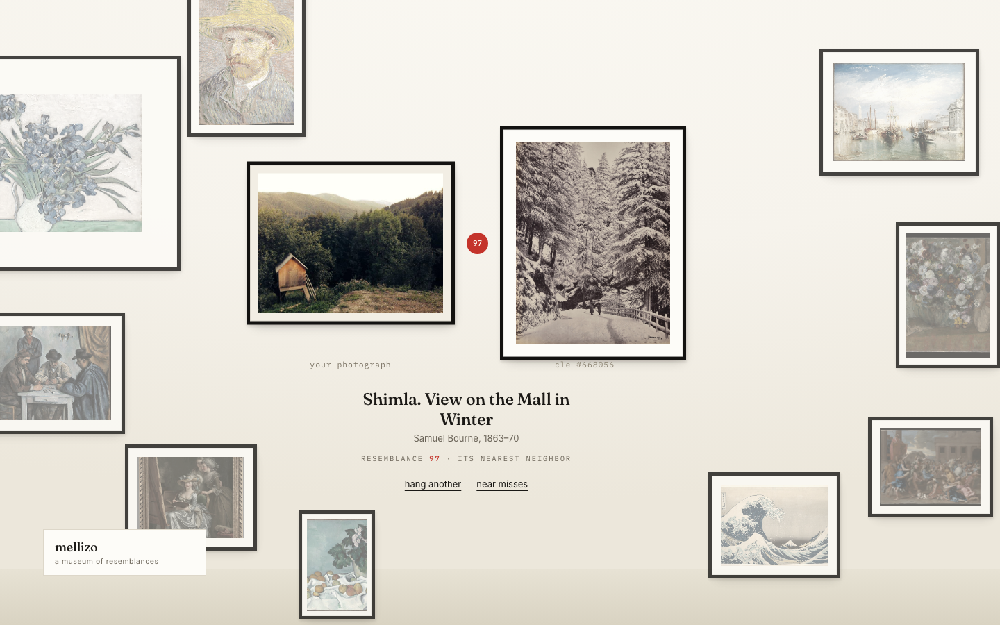

# mellizo



**Drop any photo — meet its twin among open artworks.**

https://mellizo.vercel.app

## What it does

mellizo is a daylit gallery wall. You drop a photograph — a face, a dog, a plate of pasta, a sunset — and the wall rearranges itself into a diptych: your photograph beside the open-access artwork it most resembles, hung together under a flat red resemblance mark.

The search runs against a corpus of **155,771** public-domain and open-access works from the Metropolitan Museum of Art, the National Gallery of Art, and the Cleveland Museum of Art. Your photograph never leaves your device.

And because a bare number would be asking for faith, the match explains itself: a measured one-line reading of the resemblance, plus three lenses you can switch on — palette, composition, and figure.

## How it works

Your photo is embedded locally in the browser with CLIP (`Xenova/clip-vit-base-patch32` via Transformers.js / ONNX Runtime, lazy-loaded after first paint). The 512-dimensional vector is sent — as numbers, not pixels — to a Postgres `pgvector` table on Supabase, which answers with the nearest artworks by cosine distance through an HNSW index over `halfvec(512)` storage and an RPC function. If the remote corpus is unreachable, a bundled mini-corpus of the 21 wall works takes over, so the wall always answers — and says so ("pocket corpus · twenty-one works answered").

### The resemblance reads

Every result carries a sentence and three lenses, all computed from measurements taken at ingest (palette, saliency) and in your browser (the same measurements on your photo, plus pose):

- **palette** — the five measured dominant colors of each side, with the hues they share ringed.
- **composition** — the saliency centroid and spread of each image, drawn where the eye actually lands.
- **figure** — MediaPipe pose skeletons on both sides, lazy-loaded only if you ask. When no figure is detected it says so: "no figure found on either side — the match lives elsewhere."

The sentence only claims what it measured. If palette distance, saliency overlap, pose similarity, and aspect ratio all come back weak, the fallback is honest: "the match reads its shapes and surfaces rather than any single trait."

Two corpus rules keep the match honest:

- **Degenerate images are excluded.** A work whose display image is a sliver — an aspect ratio beyond 4:1, or a side under 128px — embeds as a meaningless smear that attracts unrelated queries. They are filtered in `match_artworks`, skipped by the ingest pipeline, and guarded again client-side. When an unusually shaped work still wins, the frame shows a readable detail and says so, and a work whose image fails to load announces itself instead of hanging a blank mat.
- **The resemblance number is calibrated.** Raw CLIP cosine between a photo and its nearest artwork lands higher on a 156k corpus than a 22k one — the nearest of more works is always nearer in embedding space. The displayed score maps 0.42 → 41 and 0.95 → 97, and the caption says what it is: "an automated estimate of visual closeness — it reads surfaces, not meaning." In a blind 20-photo comparison judged by an independent vision model (a different family than the CLIP that built both arms), the old 22k corpus and the new 156k corpus split the verdict roughly evenly — more works means a nearer neighbor in embedding space, not automatically a better twin. The bigger corpus's real payoff is coverage and surprise: orchids for snowdrops, a chalkware cat for a kitten.

The interesting part is the privacy boundary: the embedding model runs entirely on-device, so the only thing that crosses the wire is the vector — a point in CLIP space, not the photograph. The match quality is also a quiet experiment in what CLIP "sees": it keys on composition, palette, and texture rather than subject, which is why a beach snapshot can come back twinned with a Monet and not a postcard.

The wall itself is a real system too: entry and result are two separate hangs of the same frames, animated between placements, so the gallery visibly rearranges around your photograph instead of swapping in a result card.

## Run locally

```bash
npm install
npm run dev
```

For the full corpus, point `.env.local` at the Supabase project:

```bash
VITE_SUPABASE_URL=...
VITE_SUPABASE_ANON_KEY=...
```

Without them the app works against the bundled mini-corpus. `VITE_MATCH_RPC` overrides the RPC name (used to drive the app against a staging table during corpus swaps).

### Rebuilding the corpus

Prerequisites: a Supabase project with the migrations in `supabase/migrations/` applied (the `mellizo` schema must be exposed in the project's API settings; RPC calls send `Content-Profile`/`Accept-Profile` headers), and `SUPABASE_URL` + `SUPABASE_SERVICE_ROLE_KEY` in the environment (the loader also falls back to `~/.config/lab/secrets.env`).

```bash
node scripts/fetch-met.mjs        # Met API catalog (gentle, resumable)
node scripts/fetch-met-wd.mjs     # Met works via Wikidata Commons links
node scripts/fetch-nga.mjs        # National Gallery of Art open-access CSV
node scripts/fetch-cle.mjs        # Cleveland open-access CSV
node scripts/fetch-aic.mjs        # Art Institute of Chicago (WAF-permitting)
node scripts/embed-v2.mjs         # patch32 embeddings + palette/saliency, resumable
node scripts/load-v2.mjs          # batch-upsert into mellizo.artworks_next
```

Embedding is resumable and parallelizable: workers scan every `data/embeddings-*.jsonl` for completed IDs and take disjoint source lists (`EMBED_SOURCES`, `EMBED_OUT`, `EMBED_SHARD`). The loader stages into `artworks_next`; the swap migration renames it into place atomically, so the live corpus never degrades mid-load. At 150k+ rows an HNSW index (`halfvec_cosine_ops`) is required — a sequential scan exceeds PostgREST's statement timeout.

## Stack

React 19 · TypeScript · Vite · Transformers.js (CLIP, on-device) · Supabase pgvector (`halfvec` + HNSW, cosine) · MediaPipe pose (lazy-loaded from CDN) · Vercel edge image proxy (`api/img.ts`, museum-host allowlist, not an open proxy)

All artwork images are public domain / CC0 or the museums' open-access equivalents, loaded hot from the museums' own CDNs (AIC and Cleveland reads route through the image proxy where hotlinking or CORS requires it). Catalogue records come from the Met's Open Access CSV and API, Wikidata Commons links, the National Gallery's open-access release, and Cleveland's public API.

## License

MIT for the code. The artworks belong to their museums and the public domain.
